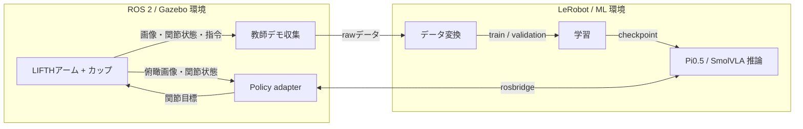

# lifth-pai

LIFTHアームを使い、Gazebo上のカップを緑色の領域へ運ぶVLA（Vision-Language-Action）実験用コードです。教師デモの収集、LeRobot形式への変換、Pi0.5 / SmolVLAの学習とGazebo上での推論を扱います。

## システム構成

ROS/Gazebo環境とML環境は分離しています。観察用の手元カメラは別途追加でき、モデル入力としては使用していません。

## 構成

| 場所 | 用途 |
| --- | --- |
| `collection/` | 環境生成、教師デモ収集、ROS側policy adapter |
| `learning/` | データ変換、学習設定、checkpoint確認、1点ずつの推論 |
| `experiments/issue7/` | 10点連続軌道と観察用手元カメラの実験用コード |
| `configs/` | シーンとpolicyの契約 |
| `dependencies.repos` | 外部基盤の取得先と固定commit |

## セットアップと実行

1. [環境準備](docs/environment.md)に従い、ROS/GazeboとMLの環境を別々に用意します。
2. [収集手順](collection/README.md)に従い、外部のロボットモデル・カップ素材を準備して教師データを収集します。
3. [学習・推論手順](learning/README.md)に従い、データを変換して学習し、保存したcheckpointを利用します。

10点連続軌道と観察用カメラの変更部分は[実験用コード](experiments/issue7/README.md)にあります。元の実験の起動・動画生成には、Git管理外の環境固有スクリプトとデータを使用したため、リポジトリだけでは全手順をそのまま再現できません。

## ライセンスと外部データ

本リポジトリ内のコードは[MIT License](LICENSE)です。外部基盤、URDF・mesh・カップ素材、事前学習済みモデルなどにはそれぞれの条件が適用されます。これらの外部素材、収集データ、学習済み重み、動画はGitに含まれていません。実行には別途取得または用意が必要です。
